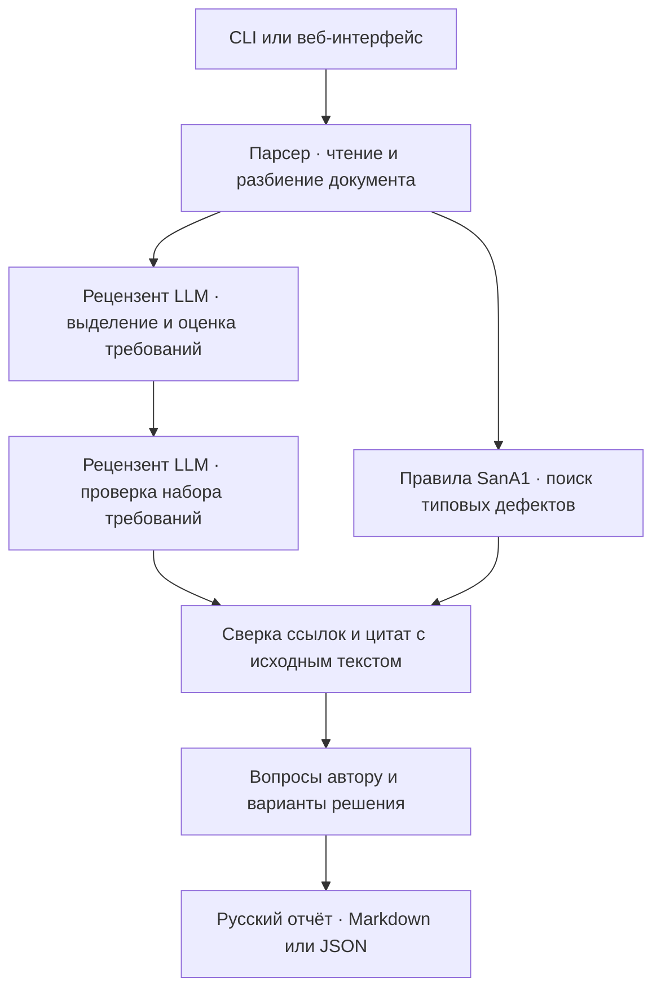

# SanA1

SanA1 reviews English and Russian specifications. Paste text or upload a TXT, Markdown, DOCX, or searchable PDF. Findings link to clauses in the formatted document. Answer a clarification, apply the revision and download an editable Word document. The local rule engine works without an account. The full audit uses the AI provider configured on the server.

## Быстрый старт для жюри

[Готовый отчёт агента](https://sana1-nine.vercel.app/reports/official.md) содержит 36 требований, 30 замечаний и 3 блокирующих дефекта. Проверка по контрольному списку подтвердила 15 из 15 тем и 115 дословных цитат. Паспорт указывает модель `gemini-3.5-flash-lite` и версию развёртывания `9ea69d7`. [Markdown в репозитории](public/reports/official.md) · [Снимок кода этого прогона](https://github.com/mansurkenma54/SanA1-Hackathon/commit/4411198450650bc3c7ed6e58b00e2552b83dc684)

[Рабочая область](https://sana1-nine.vercel.app/workspace) принимает свой файл или учебный DOCX по ссылке **Загрузить пример**. Нажмите **Проверить**. Отчёт формируется на русском независимо от языка интерфейса.

Для локального прогона установите зависимости (`python -m pip install -r requirements.txt`, Python 3.12+). Получите ключ на странице [Google AI Studio](https://aistudio.google.com/api-keys), скопируйте [.env.example](.env.example) в `.env` и заполните `GEMINI_API_KEY`. Модель задаёт `GEMINI_MODEL` (в примере `gemini-3.5-flash-lite`). Поддерживаются и другие [настройки провайдера](#ai-provider-configuration).

Сохраните [ТЗ организаторов](https://github.com/BCC-HUB/ai-requirements-validator-task/blob/928c1aa364265426105b69ba7a3444eac11b22db/docs/requirements.md) как `requirements.md` в корне SanA1 и запустите аудит одной командой.

```sh
python run.py "requirements.md" "reports/review-ru.md" --answers
```

Готовый отчёт появится в `reports/review-ru.md`. В паспорте прогона указаны фактическая модель и версия Git. Флаг `--answers` сохраняет рядом `reports/review-ru.answers.md` с вопросами, ссылками на строки и полями «Ответ».

## Run locally

Python 3.12 or later. Create a virtual environment:

    python -m venv .venv

On Windows PowerShell:

    .\.venv\Scripts\python.exe -m pip install -r requirements.txt
    .\.venv\Scripts\python.exe app.py

On macOS or Linux:

    .venv/bin/python -m pip install -r requirements.txt
    .venv/bin/python app.py

Open http://127.0.0.1:8765/workspace, load a specification and select **Check**. The log shows completed stages. If the provider fails, the report and workspace clearly label the result as rules-only. Open **Structural check** to choose a profile and view the selected structural topics and their sources.

Select **Начать** on the home page, then **Загрузить пример**. In the result, select **Перейти к исправлениям**. Open a quoted source and review the proposed edit after confirming the behavior. Queue and apply the change, then open **Файлы** for the editable document and report.

## Checks and output

In **Правки**, expand **Фильтры и вопросы автору** to filter findings by priority and criterion. Open **Детали → Требования** to search by source ID, report ID, line or text. **Детали → Паспорт** contains set-level checks and run details. For guided wording, open a finding and choose **Answer the question**.

The full audit checks explicit internal clause references in English and Russian. The web report and both exports show resolved, missing and ambiguous targets with the originating lines and declarations. Revision comparison considers the source section and original clause ID together with the quotation.

The workspace and `run.py` check up to eight public HTTP(S) references anonymously within five seconds. Each address is resolved before connecting. Private addresses are blocked, redirects are reported, and URLs with query parameters are left for manual review. GitHub 404 means public access could not be confirmed. The older offline CLI remains available with `python app.py --input ... --output ...`.

For a missing scenario, the author answers the question tied to the cited operation. The reviewer previews the wording and its position in the document before inserting it. After a recheck, the comparison and JSON export include the questions and wording approved during that revision.

The [BCC-HUB × MNU challenge](https://bcchubagents.mnu.kz/#about) covers FinTech specification quality and gives equal weight to requirement clarification, agent architecture, product value, and presentation. The [published case](https://github.com/BCC-HUB/ai-requirements-validator-task) provides the original requirements document and the submission checklist. The structural profiles in the workspace remain available as authoring aids.

## Отчёт для хакатона

Базовые настройки задаются переменными окружения. Параметр `--model` выбирает модель настроенного провайдера для одного прогона. Команда принимает Markdown, TXT, DOCX и PDF с текстовым слоем. Для сдачи используйте `.md` в UTF-8. Для автоматической обработки укажите выходной файл `.json`.

В веб-интерфейсе ту же проверку запускает **Проверить**. На широком экране режим **Рядом** показывает документ и аудит одновременно. Номер строки открывает редактор, цветная метка замечания ведёт в карточку. Текущую версию можно скачать в Word или Markdown. Изображения с читаемой подписью проверяются с участием модели. Для сканированного PDF нужен текстовый слой.

В **Результате** проверьте сводку и нажмите **Перейти к исправлениям**. В разделе **Правки** выберите приоритет и скачайте **Вопросы автору (.txt)**. В файл входят вопросы из текущего фильтра, ID требований, места в источнике и строки для ответов. После повторной проверки в разделе **Файлы** доступны проверенный документ (Word или Markdown), отчёт и JSON этого прогона.

В режиме **Markdown** виден исходный текст с номерами строк. **Добавить изображения** загружает локальные PNG, JPEG и WebP, на которые есть ссылки по имени в Markdown. Word включает прикреплённые изображения, а Markdown сохраняет ссылки. В режиме **PDF** можно перейти к любой странице загруженного файла и скачать оригинал. Страницы скана отображаются в просмотре. Для аудита PDF нужен текстовый слой.

Откройте **Разобрать замечание** и выберите фрагмент. Для денежного лимита редактор предлагает ячейку суммы. Ответ можно написать или выбрать из доступных вариантов. Модель может помочь с формулировкой. **Посмотреть правку** показывает исходный и новый текст. При изменении нескольких пунктов сравните все правки перед применением. При перепроверке сервер повторно использует проверенные оценки неизменённых блоков с прежним контекстом и заново проверяет связи по всему документу. Последний пакет правок можно отменить. В JSON сохраняются вопрос, решения и SHA-256 исходного прогона.

После загрузки документа можно включить **Восстановить после обновления**. Браузер сохраняет текст, отчёт и подготовленные правки в сессии вкладки. Выключение настройки или замена документа удаляет сохранённую копию. Для просмотра оригинала PDF после обновления загрузите файл снова. После редактирования аудит цитирует текущий текст и сохраняет отметку о неполном чтении исходного PDF.

Полная замена выделенного текста начинает новый документ. Для продолжения аудита того же ТЗ измените нужный фрагмент или примените правки из списка.

Повторный аудит показывает точные пары по критерию, вопросу и цитатам. Замечания без точной пары можно сверить с исходными цитатами и подтвердить исправление вручную. JSON содержит ссылки на исходный и новый SHA-256, сопоставление и список подтверждений.

### Аудит по локальным правилам

Выберите **Аудит по локальным правилам**, чтобы найти поддерживаемые противоречия, посмотреть доказательства и перепроверить правки без обращения к модели. Если ИИ-провайдер настроен, в редакторе можно переключиться между режимами. Сравнение правок использует два прогона одного режима.

```sh
python app.py --input "requirements.md" --output "reports/rules-review.md" --rules-only
```

В паспорте отчёта указан режим. Локальный отчёт выделяет требования по формальным признакам и показывает замечания встроенных правил. Для отчёта по ТЗ хакатона используйте команду полного ИИ-аудита.

В полном аудите исходного DOCX провайдер может получить до четырёх встроенных изображений с подписью в альтернативном тексте. SanA1 сверяет явно подписанный переход с таблицей события и статуса, если событие соответствует одной строке. Например, в отчёте можно открыть рисунок и строку, где статусы расходятся. Чтение модели требует ручной сверки. Проверка текста остаётся доступной, если провайдер не смог прочитать изображение. После правки текста повторная сверка изображения требует загрузки актуального DOCX.

### Архитектура проверки



Индивидуальная проверка и проверка набора опираются на ISO/IEC/IEEE 29148:2018 (§ 5.2.5–5.2.6) и IEEE Std 830-1998 (§ 4.3). SanA1 ищет неоднозначные, неполные и непроверяемые требования, противоречия, ошибки трассировки и необоснованные ограничения реализации.

1. **Чтение документа.** Markdown-парсер выделяет заголовки, строки таблиц, абзацы и примеры. Для DOCX сохраняются вложенность заголовков и явно отмеченные строки заголовка таблицы. Строки таблиц проверяются как отдельные блоки. Для PDF сохраняются номера страниц вместе со строками извлечённого текста.
2. **Правила и два прохода модели.** Первый проход выделяет и проверяет отдельные требования. Второй сопоставляет функциональные требования, приёмку и API по всему документу. Правила SanA1 проверяют границы периодов, сопоставление статусов API и пустые ячейки в Markdown-таблицах приёмки с явными колонками условий, действия и результата. В отчёте видно, какое замечание нашла модель, а какое — правило.
3. **Проверка доказательств.** SanA1 проверяет структуру ответа, отбрасывает неподтверждённые ссылки и выводит оригинальные цитаты. Для противоречия нужны ссылки на разные блоки.
4. **Отчёт.** Flask, CLI и веб-интерфейс используют единый результат аудита. Паспорт содержит документ, его SHA-256, дату, версию Git и фактически использованные модели. Помимо реестра требований отчёт содержит индивидуальную оценку, проверку набора, вопросы автору, число нарушений и решение о готовности.

Разбор DOCX выдаёт одну структуру разделов и таблиц для CLI и редактора. При повторном аудите изменённого текста номера пунктов и разделы позволяют сопоставить прежние замечания. В обоих режимах используются общие детекторы денежных лимитов, повторов и открытых решений. Сигналы модели объединяются с локальным правилом по совпадающей проблеме и привязке к источнику.

Коды `run.py`: `0` — запрошенный режим выполнен, `2` — ошибка входа, аргументов или записи, `3` — провайдер недоступен и сохранён отчёт по локальным правилам. Режим и причина отмечены в отчёте. При полном аудите текст передаётся настроенному провайдеру.

### Проверка перед сдачей

`python -m unittest discover -s tests -q` проверяет разметку Markdown, ссылки и цитаты, загрузку читаемого PDF, обработку ошибки модели и формирование одного отчёта через сайт и CLI. Эти тесты используют имитацию модели и работают без ключа.

GitHub Actions запускает тесты Python и JavaScript, затем проверяет шесть размеченных ситуаций, отдельные правки и полностью исправленный вариант на опубликованной версии файла организаторов. Тот же прогон и сверку готового JSON можно повторить локально.

```sh
python -m tools.check_official_case "requirements.md"
python -m tools.check_official_case "requirements.md" --report "reports/review.json"
```

Сверка JSON проверяет SHA-256, цитаты и наличие отдельных замечаний для шести контрольных ситуаций. Дополнительные находки остаются вне этой разметки и проверяются экспертом.

Для проверки на другом документе используйте [пару DOCX про возвраты по QR](docs/jury-readiness-audit.md#qr-арқылы-қайтарымның-күрделі-docx-кейсі). В ней есть вложенные разделы, таблицы, схема состояния и макет.

```sh
python -m tools.check_qr_case
python -m tools.check_qr_case tests/fixtures/qr-refund-corrected.docx
python app.py --input tests/fixtures/qr-refund-audit.docx --output reports/qr-full.json
python -m tools.check_qr_case tests/fixtures/qr-refund-audit.docx --report reports/qr-full.json
```

Первые две команды используют локальные правила. Для проверки полного аудита можно также передать JSON, скачанный с сайта. Проверяющий сверяет SHA файла и цитаты, указывает повторы и считает случай со схемой, когда отчёт приводит размеченную пару статусов. Точность чтения других рисунков требует сверки с оригиналом.

Для ручной проверки откройте отчёт по исходному кейсу и сверьте с документом цитаты, вопрос и последствия для каждого серьёзного замечания. Проверьте начисление расходов на границе месяцев, повторное уведомление после изменения порога, контракт чтения настроек, использование GET для сохранения, ответ при неверной сумме и коды доступа к чужой карте. Эти примеры входят в контрольный список команды.

### План улучшений

[Архитектура, исследовательские источники и сценарий проверки](docs/architecture-roadmap.md)

| Приоритет | Что проверить или добавить | Критерий готовности |
| --- | --- | --- |
| Перед сдачей | Сверить реальный прогон на исходном документе с контрольным списком. Повторить на мобильном экране путь от загрузки до скачивания. | Шесть контрольных ситуаций разбираются с исходными цитатами. Каждый блокирующий вывод имеет проверяемое основание. |
| Следующий этап | Составить размеченный набор небольших русских и казахских спецификаций с дефектами и исправленными парами. Оценивать правила и модель отдельно. | Для каждой конфигурации есть результаты по пропускам, ложным предупреждениям, привязке цитат и отказам сервиса. |
| Следующий этап | Улучшить контекст для длинных документов. Собирать связанные положения по идентификатору требования, разделу и операции API. | Проверка связывает функциональное правило, исключение и приёмочный пример даже через границу пакета. |
| После проверок | Сравнить pypdf и Docling для сканов, сложных таблиц и многоколоночных PDF. Сравнить облачную и локальную модель на одном эталонном наборе. | Подключение оправдано измеримым выигрышем в качестве или доступности с учётом времени запуска. |

## API for reviewers and automated tools

`GET /api/audit-contract` describes the report endpoints, input formats, limits and response fields. The workspace adds `&fallback=rules` to the AI report URL. When fallback is used, `review.ai_unavailable` identifies the provider error. The existing AI-only and rules-only endpoints remain available. Input and control coverage checks are in [the acceptance guide](docs/acceptance.md).

For text input, save this body as `audit-input.json` and send it with `Content-Type: application/json`. `filename` is optional and defaults to `requirements.md`. Use `.txt`, `.md` or `.markdown` for inline text.

```json
{"text":"Ф-1. Сервис хранит отчёт 30 дней.","filename":"requirements.md"}
```

```shell
curl --fail-with-body --json "@audit-input.json" "http://127.0.0.1:8765/api/analyze?operation=report"
```

On Windows PowerShell, use `curl.exe` for these commands. For an original PDF, DOCX, Markdown or text file, send the bytes directly and supply the filename. Percent-encode non-ASCII filenames in `X-File-Name`. Add `Accept: application/json` to receive both forms of the report.

```shell
curl --fail-with-body -H "Content-Type: application/octet-stream" -H "X-File-Name: requirements.pdf" -H "Accept: application/json" --data-binary "@requirements.pdf" "http://127.0.0.1:8765/api/analyze/gemini?operation=report"
```

The JSON response contains `review` and `markdown`. The review includes `schema_version`, `mode`, `readiness`, `warnings`, model passes, findings, and the source lines for their evidence. `sha256` represents the original bytes for a file upload and the UTF-8 bytes of `text` for inline JSON. Use `Accept: text/markdown` for a downloadable Russian report. JSON text defaults to JSON output and a file upload defaults to Markdown. API errors return a non-success HTTP status and an `error` code. If the model endpoint fails, a separate request to the local endpoint can provide an explicitly limited report.

`GET /api/evaluate/fixtures` returns the rule engine’s reference documents and labels. `GET /api/evaluate` runs that suite. To grade a new case, send JSON to `POST /api/evaluate/case` with the expected rule findings.

```json
{"text":"The app must display the transfer status quickly.","expected_findings":[{"code":"vague_requirement","lines":[1]}]}
```

Line numbers start at 1 and include blank lines. Supported labels are `vague_requirement`, `limit_conflict`, `retry_behavior`, `broken_reference`, `duplicate_clause` and `open_decision`. An empty list means no expected findings. The response lists matched, unexpected and missed findings, verifies quoted evidence, and reports whether the case passed. The workspace review endpoint `POST /api/analyze` accepts `text` and `locale` (`en` or `ru`) and returns localized guidance with each finding.

- The rule engine compares limits in matching scopes, checks vague wording and retries, resolves explicit internal references, and flags repeated clause identifiers and outstanding decisions. A final pass verifies every quote against the input.
- The workspace previews tables, embedded Word illustrations and every page of the uploaded PDF. Automated review uses the text layer and available captions.
- Each evidence link identifies its source line. The JSON export uses a versioned report schema and Unicode code-point offsets.
- Reports cover up to 50,000 characters. File uploads are limited to 4 MiB and PDFs to 40 pages. A PDF with no readable text is identified as a scan. A mixed PDF report lists pages without readable text and marks coverage as incomplete.
- The evaluation set is synthetic and measures the listed cases. For the official challenge, use its rubric and documents to extend the rules and independently measure missed findings and false alerts.

## AI provider configuration

- **Native Gemini** uses `LLM_PROVIDER=gemini` and `GEMINI_API_KEY`. Set `GEMINI_MODEL` and `GEMINI_FALLBACK_MODEL` to choose the models. An empty fallback disables automatic switching.
- **OpenAI-compatible** uses `LLM_PROVIDER=openai-compatible`, `LLM_BASE_URL`, `LLM_API_KEY` and `LLM_MODEL`. Choose a Chat Completions endpoint and a model that supports JSON mode. Use the base URL before `/chat/completions` and set `LLM_FALLBACK_MODEL` if desired. [OpenAI API](https://developers.openai.com/api/reference/resources/chat) · [DeepSeek JSON mode](https://api-docs.deepseek.com/guides/json_mode/)

Store the key as a server secret. The browser requests full audits through the existing protected `/api/analyze/gemini` path for either provider. The JSON report retains the existing `mode` value for compatibility and records the selected API in `provider`. The audit passport records the model used at each stage. Uploading extracts text locally to the SanA1 server. Starting or rerunning the full audit sends the text to the configured provider.

## Vercel

The project uses Flask with static assets in **public/**. Vercel detects **app.py** and reads **requirements.txt** and **vercel.json**. The public demo works with no cloud environment variables.
