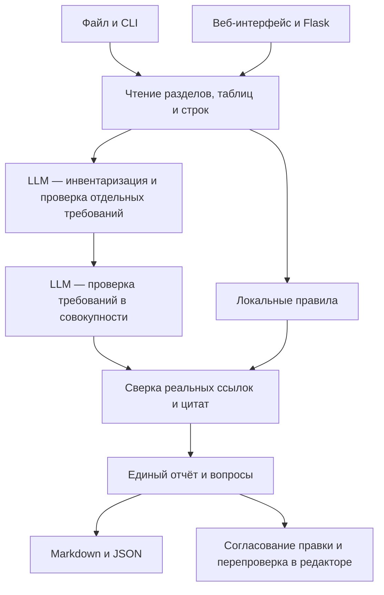

# SanA1 — ИИ-аудит технических заданий

SanA1 проверяет технические задания перед разработкой. Загрузите ТЗ на казахском, русском или английском — агент автоматически покажет результат на языке документа. Для каждого замечания он приводит исходный фрагмент, объясняет, какое решение зависит от него, и задаёт вопрос автору. Цитаты сохраняются дословно.

**Материалы для жюри** · [Открыть ТЗ хакатона в SanA1](https://sana1-nine.vercel.app/workspace?case=official) · [Прочитать отчёт по заданию](https://sana1-nine.vercel.app/reports/official.md) · [Посмотреть демо, 3:01](https://drive.google.com/file/d/1fgubvI9OrlngwchDIGBnnXaim1bgdC10/view) · [Исходное задание BCC-HUB](https://github.com/BCC-HUB/ai-requirements-validator-task/blob/928c1aa364265426105b69ba7a3444eac11b22db/README.md)

**Как проверить свой файл.** Откройте рабочую область, загрузите Markdown, TXT, DOCX или PDF с текстовым слоем и нажмите **Проверить**. Отчёт, вопросы автору и рекомендации появятся на языке ТЗ. Нажмите **Скачать отчёт (.md)**, чтобы сохранить эту версию. [Проверить свой документ](https://sana1-nine.vercel.app/workspace)

**Настройки языка.** RU / KK / EN меняет язык интерфейса. В разделе **Язык отчёта** можно выбрать другой язык для чтения и экспорта. Интерактивные карточки исправлений и исходный JSON используют русскую версию анализа. Покрытие других языков зависит от модели. Локальные правила охватывают больше всего русских и английских формулировок. Для конкурсной сдачи нужен русский отчёт.

## Что посмотреть в официальном кейсе

В ТЗ об уведомлениях по карте пункт Ф-3 ограничивает число уведомлений за месяц, а Ф-4 описывает отправку после смены порога. Клиент уже получил push и изменил порог. Должен ли банк отправить ещё один push при следующем достижении? Ответ определяет, какой счётчик реализует разработчик и какой результат проверит тестировщик.

1. На главной нажмите **Открыть ТЗ хакатона**, затем **Проверить**. Для пробы на другом материале можно загрузить свой файл или учебный DOCX про QR-возвраты. [Исходное ТЗ](https://github.com/BCC-HUB/ai-requirements-validator-task/blob/928c1aa364265426105b69ba7a3444eac11b22db/docs/requirements.md) · [Учебный DOCX в рабочей области](https://sana1-nine.vercel.app/workspace?demo=audit)
2. В **Итоге** посмотрите вывод, блокирующие дефекты и режим прогона. **Отдельные требования** показывает проверку каждого пункта, **Набор в целом** — связи между ними. Кнопка **Показать в ТЗ** ведёт к основанию. В разделе **Язык отчёта** можно скачать русский оригинал для жюри.
3. Через **Правки** откройте вопрос о повторном push и сверьте Ф-3 и Ф-4. Автор выбирает, сохраняется ли месячный лимит или смена порога допускает повторную отправку. Сравните новую формулировку с исходной, подтвердите и запустите перепроверку. В **Файлах** скачайте исправленную спецификацию.

В опубликованном прогоне агент индивидуально оценил 36 из 36 требований. Он выделил 25 замечаний, включая 3 блокирующих, и поставил вопросы о месяце учёта покупки, повторном push и ответе API при ошибке. При сверке 111 цитат совпали со строками исходного ТЗ. В паспорте указан серверный коммит `26dc407`. Для жюри опубликован снимок того же кода и исходные результаты этого прогона. [Открыть Markdown](public/reports/official.md) · [Скачать Markdown, JSON и лист вопросов](https://github.com/mansurkenma54/SanA1-Hackathon/releases/tag/jury-2026-11-27) · [Код прогона](https://github.com/mansurkenma54/SanA1-Hackathon/tree/fa3d5d45adcb698149d314d3ce6a54fe65fc4be9)

## Как воспроизвести отчёт

Понадобятся Git, Python 3.12+ и ключ LLM. Команды ниже выполняются в каталоге клона. Исходный файл и результаты складываются в соседнюю папку `sana1-run`, чтобы сохранить их рядом с кодом сдачи и получить чистый Git SHA в паспорте.

```sh
git clone https://github.com/mansurkenma54/SanA1-Hackathon.git
cd SanA1-Hackathon
```

**Windows PowerShell**

```powershell
python -m venv .venv
.\.venv\Scripts\Activate.ps1
python -m pip install -r requirements.txt
Copy-Item .env.example .env
curl.exe -fL --create-dirs -o ../sana1-run/requirements.md https://raw.githubusercontent.com/BCC-HUB/ai-requirements-validator-task/928c1aa364265426105b69ba7a3444eac11b22db/docs/requirements.md
```

Если в PowerShell отключена активация окружений, используйте `.\.venv\Scripts\python.exe` вместо `python` в оставшихся командах.

**macOS или Linux**

```sh
python3 -m venv .venv
. .venv/bin/activate
python -m pip install -r requirements.txt
cp .env.example .env
curl -fL --create-dirs -o ../sana1-run/requirements.md https://raw.githubusercontent.com/BCC-HUB/ai-requirements-validator-task/928c1aa364265426105b69ba7a3444eac11b22db/docs/requirements.md
```

Получите ключ в Google AI Studio и заполните `GEMINI_API_KEY` в локальном `.env` рядом с `run.py`. Оставьте `LLM_PROVIDER=gemini`. В примере основной моделью выбрана `gemini-3.5-flash-lite`. При необходимости укажите доступную вашему ключу модель через `GEMINI_MODEL`. Git исключает `.env` из репозитория. [Создать ключ](https://aistudio.google.com/api-keys) · [Образец настроек](.env.example)

**Одна команда для полного аудита на русском по требованиям жюри**

```sh
python run.py ../sana1-run/requirements.md ../sana1-run/review.md --language ru --answers --json
```

| Файл в `sana1-run` | Содержимое |
| --- | --- |
| `review.md` | Отчёт на русском для сдачи, включая решение о готовности к разработке и тестированию. |
| `review.answers.md` | Вопросы со ссылками на исходные строки и местом для согласованного ответа. |
| `review.json` | Структурированные данные того же прогона для программной сверки отчёта. |

Первый аргумент задаёт путь к вашему документу, второй — путь к результату. Для своего ТЗ достаточно двух путей. По умолчанию действует `--language auto`. Для казахского, русского и английского ТЗ язык Markdown определяется по содержимому файла. Для одного JSON укажите выходной путь с расширением `.json`. Повторный запуск модели может дать другие формулировки. Для сверки одного результата используйте файлы, созданные вместе.

Для команды с другим рабочим языком задайте `--language` и отдельный путь к Markdown. Например, эта команда создаёт казахскую версию отчёта.

```sh
python run.py ../sana1-run/requirements.md ../sana1-run/review-kk.md --language kk
```

Для английского укажите `--language en`. Для другого языка можно передать его название, например `--language Deutsch`. Настроенная модель переводит пояснения и вопросы. Цитаты, идентификаторы требований, ссылки на строки и данные прогона сохраняют связь с первоисточником. `--answers` создаёт лист вопросов на языке итогового Markdown. `--json` сохраняет исходный аудит с полем `source_language`. Для конкурсной сдачи используйте русский Markdown согласно § 6 задания. [Состав отчёта](https://github.com/BCC-HUB/ai-requirements-validator-task/blob/928c1aa364265426105b69ba7a3444eac11b22db/README.md#6-состав-отчёта)

| Код завершения | Что произошло |
| --- | --- |
| `0` | Агент завершил запрошенный режим. В паспорте полного аудита перечислены фактические модели. |
| `2` | Ошибка чтения, формата, аргументов или записи. Причина выводится в терминал. |
| `3` | Полный аудит запросили, но модель оказалась недоступна. Сохранён отчёт по правилам с причиной ограничения. Проверьте ключ, модель или квоту и повторите полный запуск. |

Для автономного прогона добавьте `--rules-only`. При этом режиме или переходе на правила из-за недоступности модели CLI сохраняет отчёт на русском и указывает режим проверки. Перевод требует доступа к модели. Для локального веб-интерфейса выполните `python app.py` в том же окружении и откройте [рабочую область](http://127.0.0.1:8765/workspace).

## Что именно проверяет агент

Индивидуальный проход рассматривает свойства формулировки из ISO/IEC/IEEE 29148:2018 (§ 5.2.5) и IEEE 830-1998 (§ 4.3), в том числе однозначность, единичность, проверяемость, полноту и обоснованность ограничений реализации. Затем агент проверяет набор (§ 5.2.6) по четырём направлениям — полнота, непротиворечивость, прослеживаемость и реализуемость. Статусы отмечают обнаруженную проблему, недостаток сведений или отсутствие обнаруженных признаков проблемы. Отдельные структурные профили интерфейса служат подсказкой при оформлении ТЗ. [Критерии в постановке задачи](https://github.com/BCC-HUB/ai-requirements-validator-task/blob/928c1aa364265426105b69ba7a3444eac11b22db/README.md)

| Требование к отчёту | Где проверить |
| --- | --- |
| Идентификация прогона | **Паспорт прогона** содержит название и SHA-256 файла, дату, Git SHA и модели по этапам. |
| Выделение требований | **Выделенные требования** связывает ID отчёта с ID автора, кратким описанием и строкой. У ненумерованных пунктов остаются ID агента и дословная цитата в карточке. |
| Проверка каждого пункта | **Проверка каждого требования** даёт вывод и основание для каждой записи реестра, включая пункты без выявленных проблем. |
| Связи по всему ТЗ | **Проверка набора требований** сопоставляет правила, условия приёмки и контракты API из разных разделов. |
| Обоснование нарушения | **Найденные нарушения** и **Вопросы автору ТЗ** показывают приоритет, последствия, вопрос и цитаты. Для противоречия приводятся минимум два исходных блока. |
| Решение для команды | **Сводка и готовность к разработке** даёт числа требований и нарушений, список критичных дефектов, вывод и приоритетные действия. |

## Как оценить SanA1 по критериям жюри

| Критерий | Вес | Что можно проверить |
| --- | ---: | --- |
| Уточнение требований | 25% | Найдите в отчёте вопрос по Ф-3 и Ф-4. Оба допустимых ответа описывают разное поведение продукта. Вопрос со ссылками доступен в листе для автора. |
| Архитектура | 25% | Проследите путь от входного файла до двух проходов модели и сверки цитат. Повторите тот же аудит через CLI или сайт, сравните хэш входа и паспорт. |
| Ценность и качество продукта | 25% | Откройте блокирующий дефект, сверьте строки, согласуйте изменение и перепроверьте документ. Для независимой пробы есть ошибочный и исправленный DOCX по QR-возвратам. |
| Презентация и защита | 25% | В записи можно проследить загрузку документа, аудит, вопрос с выбором и экспорт. По ссылке на сайт этот путь можно повторить со своим ТЗ. |

Вес публикуют организаторы. Разметка команды измеряет покрытие конкретных случаев. [Критерии жюри](https://bcchubagents.mnu.kz/#judging) · [Контрольные случаи и результаты по версиям](docs/acceptance.md)

## Работа со своим документом

В разделе **Отдельные требования** найдите пункт по ID, строке или тексту. Из карточки замечания можно открыть цитату в документе. Фильтры по приоритету и критерию помогают готовить вопросы конкретному владельцу продукта. Для таблиц редактор показывает изменяемые ячейки, для текста — формулировку до и после правки. Последний применённый пакет правок можно отменить.

После проверки английского или казахского документа сайт автоматически открывает **Язык отчёта** и готовит его версию на языке источника. Нажмите **Скачать отчёт (.md)**, чтобы сохранить её. Для другой аудитории выберите целевой язык, при необходимости через **Другой язык**, и нажмите **Перевести**. При просмотре перевода кнопка **Скачать оригинал (RU)** сохраняет русский отчёт для жюри.

При перепроверке редактор сопоставляет прежние и новые замечания по критерию, вопросу и цитатам. Неоднозначные пары можно сверить вручную. Текущую версию ТЗ можно скачать в Word или Markdown, отчёт — в Markdown или JSON. Загруженный PDF можно просматривать по страницам. Добровольное сохранение сессии восстанавливает текст и подготовленные правки после обновления вкладки. Для просмотра оригинального PDF его нужно загрузить повторно.

## Архитектура



Извлечение текста хранит привязку к строкам, таблицам и страницам. Индивидуальная проверка разбивается на пакеты. Второй проход получает контекст всего документа. Перед выпуском результата SanA1 сверяет ссылки с извлечёнными блоками. Согласие автора и новая проверка нужны, чтобы оценить эффект предложенной правки. [Чтение файлов](document_input.py) · [Промпты и схемы ответа](hackathon_review.py) · [Правила](review_rules.py) · [Сборка отчёта](hackathon_cli.py)

## Как проверить результат

```sh
python -m tools.check_expanded_acceptance ../sana1-run/requirements.md --report ../sana1-run/review.json
python -m tools.check_official_case ../sana1-run/requirements.md
python -m tools.check_qr_case
python -m tools.check_qr_case tests/fixtures/qr-refund-corrected.docx
```

Первая команда сверяет SHA-256, дословные цитаты и согласуемые вопросы по 15 темам команды. Вторая запускает локальные правила и проверяет шесть размеченных ситуаций на исходнике и вариантах с точечными исправлениями. Последние две запускают правила на независимой паре документов. Обнаружение размеченных дефектов не измеряет долю всех возможных пропусков и ложных срабатываний на других ТЗ. [Подробная приёмка](docs/acceptance.md) · [Сценарии GitHub Actions](.github/workflows/checks.yml)

Для тестов движка и редактора ключ не нужен. В CI используются Python 3.13 и Node.js 24.

```sh
python -m unittest discover -s tests -q
node --test tests/test_audit_comparison.mjs tests/test_audit_repair.mjs tests/test_document_view.mjs tests/test_workspace_session.mjs tests/test_audit_questions.mjs
```

## Подключение, API и ограничения

- **Провайдер.** Для Gemini используются `GEMINI_API_KEY`, `GEMINI_MODEL` и необязательная резервная `GEMINI_FALLBACK_MODEL`. Для совместимого Chat Completions API укажите `LLM_PROVIDER=openai-compatible`, `LLM_BASE_URL` до пути `/chat/completions`, `LLM_API_KEY` и `LLM_MODEL` с поддержкой JSON. При полном аудите текст передаётся выбранному провайдеру. В Vercel эти переменные задаются на сервере.
- **API.** `GET /api/audit-contract` описывает форматы входа и ответа. Для аудита файла передайте исходные байты с `Content-Type: application/octet-stream` и `X-File-Name`. Для текста подойдёт JSON с полями `text` и `filename`. Для ответа с Markdown и JSON в одном запросе укажите `Accept: application/json`. [Контракт опубликованного API](https://sana1-nine.vercel.app/api/audit-contract)
- **Объём.** Один файл до 4 МиБ, до 50 000 символов текста и до 40 страниц PDF. Для скана нужен текстовый слой. У смешанного PDF отчёт отмечает нечитаемые страницы. Для DOCX используется текст и до четырёх встроенных иллюстраций с доступной подписью. Визуальные выводы стоит сверять с оригиналом.
- **Источники.** Агент проверяет до восьми публичных HTTP(S)-адресов за пять секунд. Приватные адреса, ссылки с параметрами запроса и редиректы требуют отдельной проверки. SHA-256 считается по исходным байтам загруженного файла, для вставленного текста — по UTF-8.
- **Локальный режим.** Доступные проверки покрывают конкретные классы дефектов, включая несовместимые лимиты, незавершённые решения и битые внутренние ссылки. Паспорт указывает выбранный режим. Для хакатона нужен полный прогон с вызовом модели.

Эта команда отправляет исходный файл локальному серверу и получает обе формы отчёта.

```sh
curl --fail-with-body -H "Content-Type: application/octet-stream" -H "X-File-Name: requirements.md" -H "Accept: application/json" --data-binary "@../sana1-run/requirements.md" "http://127.0.0.1:8765/api/analyze/gemini?operation=report"
```

В PowerShell используйте `curl.exe`. Поле `review` содержит структурированное представление, `markdown` — текст отчёта. Для проверки алгоритмов по собственной разметке доступны `GET /api/evaluate/fixtures`, `GET /api/evaluate` и `POST /api/evaluate/case`. Описание измерений и ограничений доступно в [журнале приёмки](docs/acceptance.md).
